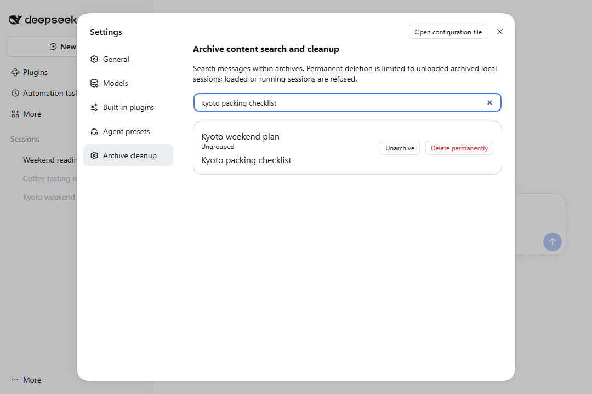
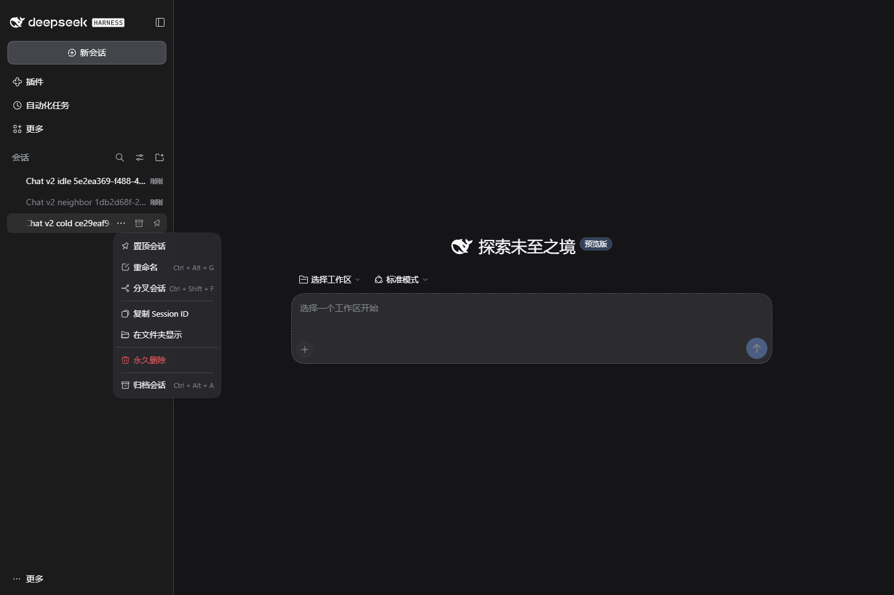
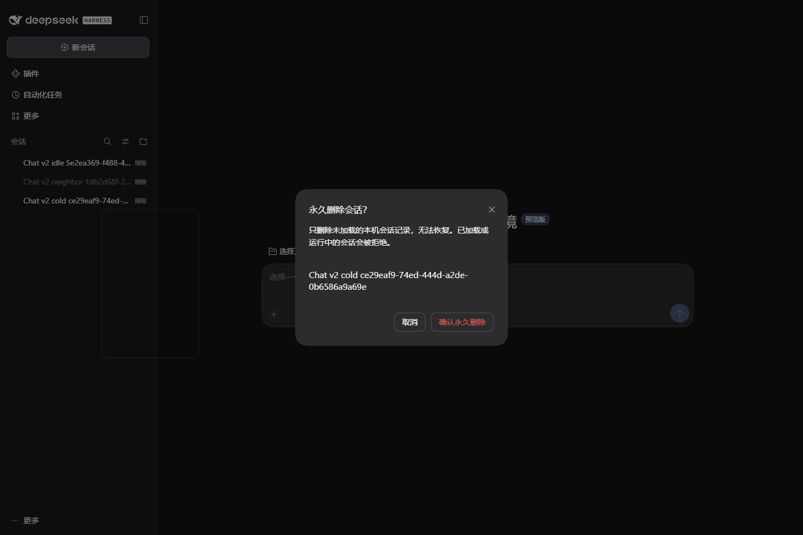

# DSH Chat Manager

[简体中文](README.md) · [Releases](https://github.com/WSL043/dsh-chat-manager/releases) · [Qualified DSH versions](compatibility.json)

> [!IMPORTANT]
> **Manual maintenance has ended.**
>
> I use [`@michengai/dsh-archive-manager`](https://github.com/MichengAI/dsh-archive-manager) for my own archived chats. The existing automation may still publish compatibility patches that pass acceptance checks.

DSH Chat Manager adds archive-only message search and confirmed cleanup to DeepSeek Harness. Open **Settings → Archive cleanup** to find archived messages. Use a session's context menu or an archive search result to request permanent deletion. Both entries show the session name and ask for confirmation.

DSH provides the workspace, regular search, archive, restore, and the shared session menu. The archive search narrows the official query to archived sessions before the result limit. It uses bounded event filtering when the optional full-text index is disabled.

## Install or update

Open **Plugins → Add plugin** in official DeepSeek Harness 0.2.2-rc.1 and paste this package spec:

```text
dsh-chat-manager@2.0.1
```

Check the [qualified DSH versions](compatibility.json) for newer v2 releases. The [v1 maintenance line](https://github.com/WSL043/dsh-chat-manager/tree/stable) documents earlier versions.

## Archive cleanup

Choose **Delete permanently** in the row menu of an archived or unarchived session. Open **Settings → Archive cleanup** to find archived sessions by message content.



<details>
<summary>Unarchived session menu and confirmation</summary>





</details>

## Permanent deletion

Permanent deletion cannot be undone. Only unloaded local sessions using the current JSONL format can be deleted. The plugin verifies the target under the official exclusive write handle. It refuses loaded sessions, running or pending activity, other writers, and historical formats. An incomplete cleanup reports the retained quarantine and preserves any existing archive marker.

External attachments, caches, backups, cloud copies and non-JSONL stores fall outside this operation. Uninstalling the plugin preserves sessions.

[Report an issue](https://github.com/WSL043/dsh-chat-manager/issues/new/choose) · [Security](SECURITY.md) · [MIT](LICENSE) · [Third-party notices](THIRD_PARTY_NOTICES.md)

This community plugin is independent of DeepSeek.
