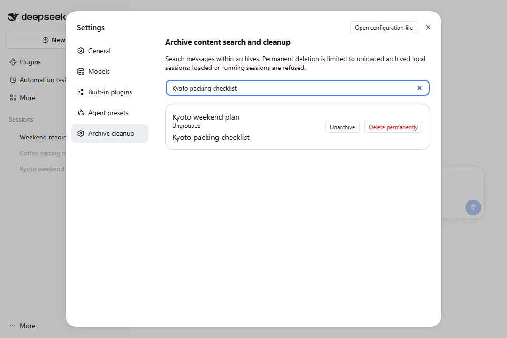
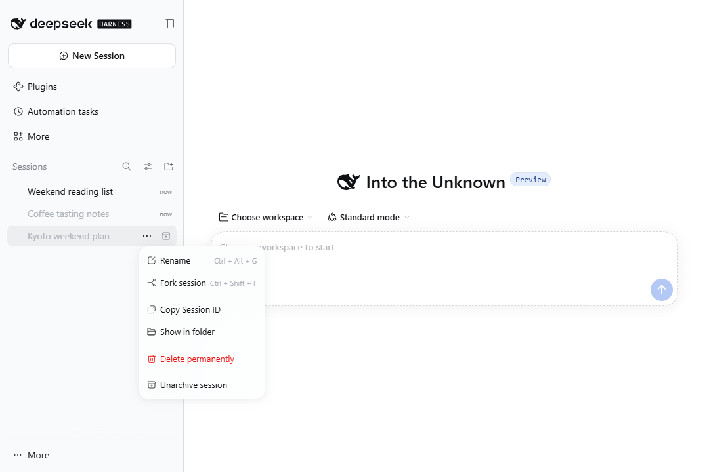
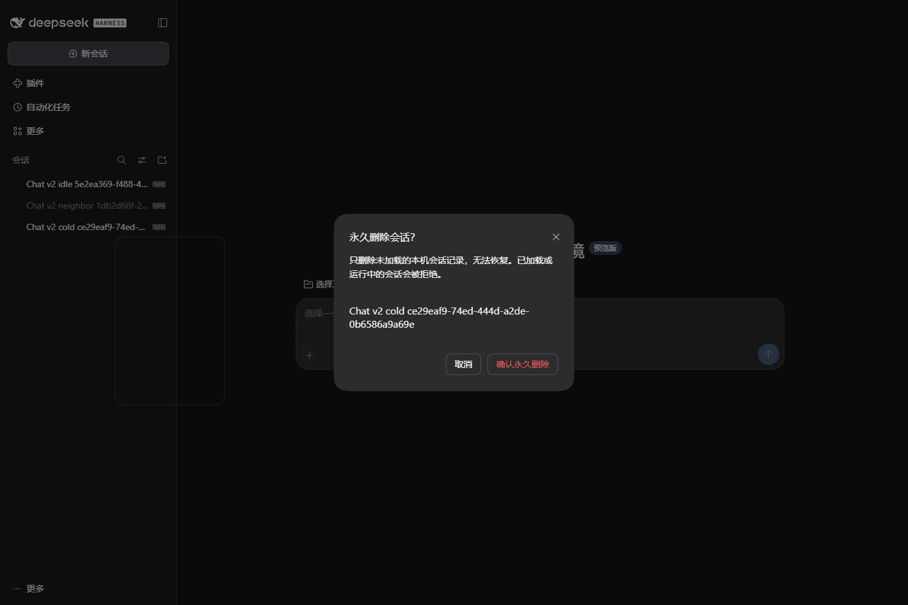

# DSH Chat Manager · 会话管理

[English](README.en.md) · [发布版本](https://github.com/WSL043/dsh-chat-manager/releases) · [已验收的 DSH 版本](compatibility.json)

在 DeepSeek Harness 的 **设置 → 归档清理** 中搜索已归档的聊天内容。从搜索结果或已归档会话的菜单打开永久删除。两个入口都会显示会话名称，并要求再次确认。

工作区、常规搜索、归档、恢复和会话菜单由 DSH 提供。归档搜索在官方查询达到结果上限前限定归档范围。关闭全文索引时，使用有限并发的官方事件筛选。

## 安装与更新

在官方 DeepSeek Harness 0.2.2-rc.1 中打开 **插件 → 添加插件**，粘贴以下包名和版本：

```text
dsh-chat-manager@2.0.0
```

更新到后续 v2 版本前，可查看[已验收的 DSH 版本](compatibility.json)。旧版说明见 [v1 维护分支](https://github.com/WSL043/dsh-chat-manager/tree/stable)。

v2 从 DSH 0.2.2-rc.1 开始支持。后续补丁跟随官方发布，新内核和上一受支持版本均通过验收后才发布。详见[维护指南](docs/stable-maintenance.md)。

## 归档清理

先归档会话，在侧栏显示已归档会话后，行菜单才会出现 **永久删除**。也可以打开 **设置 → 归档清理**，按消息内容找到会话。



<details>
<summary>已归档会话的菜单与删除确认</summary>





</details>

## 永久删除

永久删除无法撤销。仅支持已经归档、未被宿主加载、采用当前 JSONL 格式的本机会话。插件先取得官方独占写入句柄，再核验目标并清理。仍在加载的会话、其他写入者占用的会话和旧格式均会被拒绝。清理未完成时会保留归档标记并报告隔离区状态。

清理范围不含外部附件、缓存、备份、云端副本和其他存储格式。卸载插件会保留会话。

[问题反馈](https://github.com/WSL043/dsh-chat-manager/issues/new/choose) · [安全](SECURITY.md) · [MIT](LICENSE) · [第三方说明](THIRD_PARTY_NOTICES.md)

本插件由社区独立维护。
